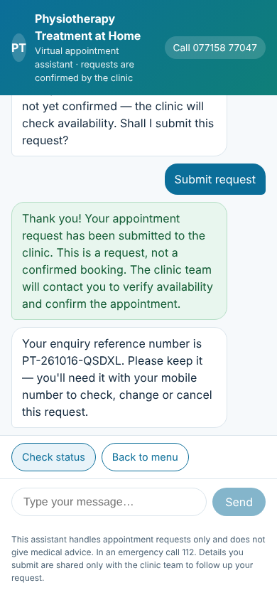
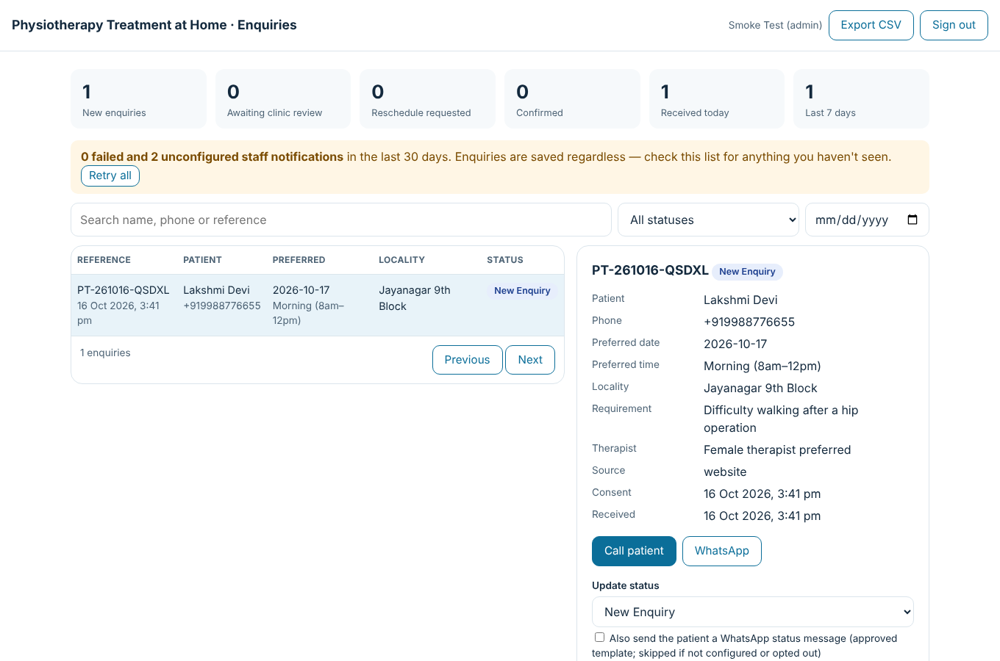

# Physiotherapy Treatment at Home — AI Appointment-Enquiry Assistant

A website chatbot, WhatsApp assistant and secure staff dashboard. Together they collect **home physiotherapy appointment requests**, answer common questions using verified business facts only, store every request in PostgreSQL and alert the clinic team.

> Every submission is an **appointment request, not a confirmed booking**. Only clinic staff can mark a request as *Confirmed* in the dashboard.

| Website chat (mobile) | Staff dashboard |
|---|---|
|  |  |

## What it does
- **Chat assistant** (`/chat`, embeddable via `public/widget.js`): greeting, four main options, step-by-step request form (name → mobile → date → time → locality → reason → therapist preference → consent → summary → submit), reference number, request-status lookup (reference + mobile), patient cancel / reschedule, FAQs, and "speak with the clinic" with the clinic's phone number.
- **Medical safety:** never diagnoses or prescribes. Urgent symptoms trigger "call 112 / 108 or go to an emergency department" advice, and the request is flagged for staff.
- **No invented facts:** prices, service areas, specific treatments and availability always get the standard "the clinic team can confirm" reply (`lib/business.ts`, `lib/faq.ts`).
- **Optional AI** (Groq or any OpenAI-compatible API): only *classifies* free-text messages into a fixed list of intents. It never writes the replies patients see. Without a key, the assistant runs on rules.
- **Staff dashboard** (`/staff`): login, roles (admin / staff), search by name / phone / reference, filter by status and date, status changes with history, internal notes, call / WhatsApp links, metrics, notification failures with retry, integration status, CSV export (admin only), deletion of records on request (admin only).
- **Notifications:** saved to an outbox first, then sent by email (SMTP) and/or WhatsApp template. Every attempt and error is logged, and failures can be retried from the dashboard or a scheduled job.
- **WhatsApp Cloud API:** webhook signature check, handshake verification, protection against duplicate events, STOP/START opt-out, delivery-status tracking, template-only messages started by the clinic.

## Quick start (local)
```bash
npm install
cp .env.example .env.local          # set DATABASE_URL at minimum
npm run migrate                     # creates tables (idempotent)
npm run create-admin -- --email you@clinic.example --name "Your Name"   # prompts for a password
npm run dev                         # http://localhost:3000
```
- Patient chat: `http://localhost:3000/chat`
- Staff dashboard: `http://localhost:3000/staff`
- Health check: `http://localhost:3000/api/health`

## Tests
```bash
createdb physio_test   # or set TEST_DATABASE_URL
npm test               # 35 tests: conversation, validation, DB, notifications, auth, WhatsApp, DB outage
npm run typecheck
```

## Embedding on the clinic website
```html
<script src="https://YOUR-APP-DOMAIN/widget.js" defer></script>
```
Set `CHAT_EMBED_ALLOWED_ORIGINS` to the website's origin(s).

See [docs/DEPLOYMENT.md](docs/DEPLOYMENT.md) for hosting, WhatsApp and email setup. See [docs/CHECKLIST.md](docs/CHECKLIST.md) for what has been tested, what is configured and what still needs setting up.
